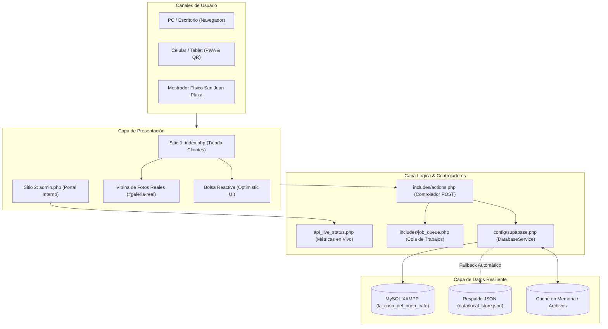
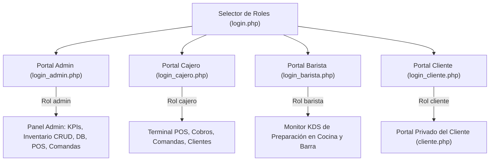
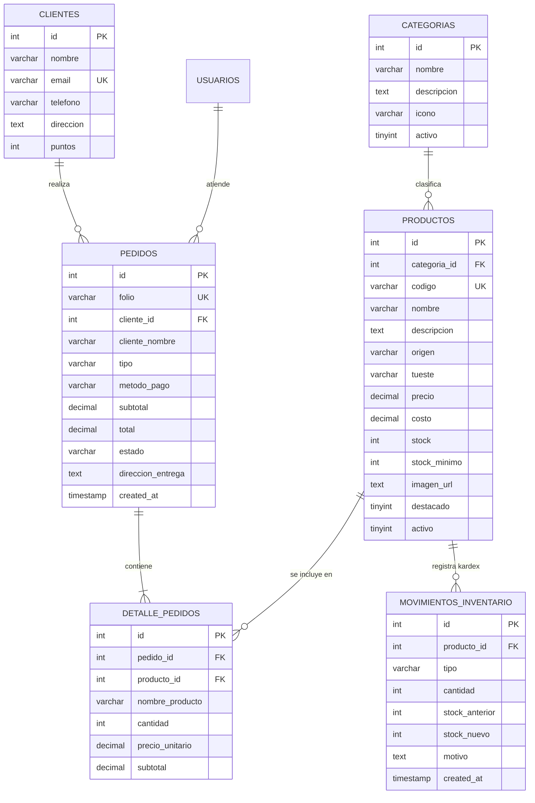

# Documentación Profesional y Manual Integral del Sistema
## La Casa del Buen Café — Specialty Coffee Roasters & Tienda eCommerce PWA

---

## 1. Ficha Técnica y Resumen Ejecutivo

| Parámetro | Especificación Oficial |
| :--- | :--- |
| **Nombre Comercial** | La Casa del Buen Café® |
| **Razón de Ser** | Cafetería de Especialidad, Tostaduría Artesanal, Repostería & Tienda Online |
| **Punto Físico Oficial** | Calle 26 # 16-24 Centro Comercial San Juan Plaza, Local 151 Primer Piso, Neiva - Huila, Colombia |
| **Horario de Atención** | Lunes a Viernes: 9:00 AM - 8:00 PM \| Sábados y Domingos: 10:00 AM - 8:00 PM |
| **Puntaje de Café** | Micro-lotes de origen Huila con puntaje de catación SCA 86+ |
| **Arquitectura** | Dual Web (Sitio 1: Tienda eCommerce PWA para Clientes \| Sitio 2: Portal Interno ERP / POS / Admin) |
| **Stack Backend** | PHP 8.x nativo orientado a servicios, PDO Persistente, Server-Sent Events (SSE) para IA |
| **Base de Datos** | MySQL / MariaDB (XAMPP Port 3306) con capa resiliente de respaldo local JSON (`data/local_store.json`) |
| **Stack Frontend** | Tailwind CSS CDN, FontAwesome 6.5.1, JavaScript ES6+ Vanilla Reactivo (0 dependencias pesadas) |
| **Optimización Web** | Compresión Gzip/Brotli, Debounce (220ms), Paginación virtualizada, Optimistic UI (0ms lag), Skeleton Loader |

---

## 2. Arquitectura del Sistema

El ecosistema de **La Casa del Buen Café** opera bajo un modelo desacoplado y de alta resiliencia. Si el servicio MySQL está activo en XAMPP, el sistema utiliza transacciones relacionales con índices B-Tree de alta velocidad; si el servicio de base de datos se detiene por mantenimiento, el motor conmuta automáticamente a la capa de almacenamiento JSON sin interrumpir la atención de clientes ni la facturación.



---

## 3. Inventario y Asignación de Fotos Reales

El sistema integra todas las fotografías auténticas de los productos tomadas directamente en el establecimiento físico, ubicadas en el directorio `uploads/` y `assets/`:

| ID | Código | Nombre del Producto | Categoría | Precio (COP) | Stock | Imagen Oficial Asignada | Tipo de Imagen |
| :---: | :--- | :--- | :--- | :---: | :---: | :--- | :--- |
| **1** | `TOR-001` | Torta Húmeda de Café y Nueces | Tortas | \$11.500 | 20 | Unsplash Especializada (WebP) | CDN Optimizada |
| **2** | `TOR-002` | Torta Casera de Zanahoria | Tortas | \$10.500 | 15 | Unsplash Especializada (WebP) | CDN Optimizada |
| **3** | `GALIN-99` | Galletas Integral de Avena | Galletas Integral | \$3.500 | 20 | Unsplash Especializada (WebP) | CDN Optimizada |
| **4** | `EMP-001` | Empanada Mixta Especial | Empanadas Mixtas | \$6.000 | 10 | `uploads/prod_1793470733_605.png` | **Foto Real del Local** |
| **5** | `EMP-002` | Empanada de Carne Tradicional | Empanadas de Carne | \$6.000 | 10 | `uploads/prod_1793470620_604.png` | **Foto Real del Local** |
| **6** | `EMP-69` | Empanada Criolla de Pollo | Empanadas de Pollo | \$6.000 | 10 | `uploads/prod_1793470380_426.png` | **Foto Real del Local** |
| **7** | `PLA-001` | Paquete Platanitos Mixtos 150g | Platanitos Mixtos | \$6.500 | 50 | `uploads/prod_1794079260_727.jpg` | **Foto Real del Local** |
| **8** | `PLA-002` | Platanitos Maduros Dulces 150g | Platanitos Maduros | \$6.000 | 40 | `uploads/prod_1794079588_669.jpg` | **Foto Real del Local** |
| **9** | `PLA-003` | Platanitos Verdes Sal Marina 40g | Platanitos Verdes | \$3.500 | 5 | `uploads/prod_1794073674_501.jpg` | **Foto Real del Local** |
| **10** | `BEB-001` | Cappuccino Artesanal 8oz | Bebidas | \$8.500 | 120 | Unsplash Especializada (WebP) | CDN Optimizada |
| **11** | `BEB-002` | Cold Brew Naranja & Café | Bebidas | \$11.500 | 45 | Unsplash Especializada (WebP) | CDN Optimizada |
| **12** | `CAF-001` | Café Reserva Huila 500g | Bebidas | \$42.000 | 35 | Unsplash Especializada (WebP) | CDN Optimizada |
| **13** | `TORED-84` | Torta Red Velvet | Tortas | \$6.000 | 9 | `red velvet web_640x200.jpg` | Imagen de Catálogo |
| **14** | `SPEE-95` | Speed Max Energizante | Bebidas | \$3.500 | 25 | `uploads/prod_1793473739_358.jpg` | **Foto Real del Local** |
| **15** | `AGUILI45` | Cerveza Águila Light | Bebidas | \$5.000 | 22 | `uploads/prod_1793473266_255.jpg` | **Foto Real del Local** |
| **16** | `PLAMC-073` | Platanitos Mix de Chicharrón 40g | Platanitos Mix Chicharrón | \$35.000 | 8 | `uploads/prod_1794080699_803.jpg` | **Foto Real del Local** |
| **Logo** | `BRAND` | Sello Oficial La Casa del Buen Café | Identidad | N/A | N/A | `assets/logo.jpg` \| `logo.php` | **Foto Real del Local** |

---

## 4. Manual de Usuario: Sitio 1 — Tienda Online de Clientes (`index.php`)

### 4.1. Barra Superior y Cintillo Promocional
- **Beneficios Destacados**: Información sobre *Envío Gratis* y el programa de fidelización *Club del Buen Café* (1 Punto por cada \$1.000 COP comprados).
- **Acceso Multidispositivo / QR**: Botón que despliega el código QR para escanear y cargar la tienda directamente en celulares Android, iPhone o tabletas conectadas a la red.
- **Acceso al Portal Interno**: Enlace discreto para ingresar a la plataforma administrativa.

### 4.2. Catálogo Dinámico y Sistema de Filtros
El catálogo categoriza automáticamente los 16 productos mediante 5 filtros temáticos rápidos:
1. **Todos los Productos**: Vista general del menú con contador dinámico de referencias disponibles.
2. **Bebidas**: Cafés calientes (Cappuccino, Espresso), filtrados, bebidas frías (Cold Brew), energizantes (Speed Max) y cervezas.
3. **Empaquetados**: Paquetes sellados de platanitos (Verdes, Maduros, Mixtos, Mix con Chicharrón), café en grano/molido 500g y galletas integrales.
4. **Comidas**: Toda la repostería artesanal, tortas caseras, galletas y empanadas recién horneadas.
5. **Tortas**: Especialidades dulces (Torta Húmeda de Café y Nueces, Torta de Zanahoria, Torta Red Velvet).
6. **Empanadas**: Empanadas Mixtas con queso, Empanadas de Carne tradicional y Empanadas criollas de Pollo.

### 4.3. Buscador Ultrarrápido con Debounce y Autocompletado
- **Debounce de 220ms**: Al tipear en el campo de búsqueda, el sistema no satura el procesador del dispositivo, esperando a que el usuario termine de escribir.
- **Autocompletado Predictivo**: Muestra hasta 4 coincidencias inmediatas con nombre y precio.
- **Botón de Limpieza Rápida**: Un clic borra el término y restaura la paginación a la página 1.

### 4.4. Paginación y Virtualización del Catálogo
- Presenta bloques óptimos de **6 productos por página**, permitiendo una navegación ágil en dispositivos móviles de gama baja y conexiones 3G/4G.
- Barra de paginación interactiva con botones *Anterior* / *Siguiente*, indicador de página actual y conteo de productos mostrados.

### 4.5. Vitrina Auténtica de Fotos Reales
Ubicada bajo el menú, esta sección visual exhibe las **10 fotos reales tomadas en el local físico**:
- Tarjetas con diseño de cristal (*glass-card*), etiquetas distintivas (*Recién Horneada*, *Extra Crocante*, *Snack Estrella*, *Bien Frío*) y botón directo de compra que agrega el producto a la bolsa con un solo toque.

### 4.6. Bolsa de Compras con Actualización Optimista (0ms Lag)
- Al hacer clic en **Comprar**, el producto ingresa de inmediato a la memoria local (`storeCart`), actualizando el contador del encabezado, el subtotal y los puntos Club ganados con cero retraso de red.
- Permite incrementar, decrementar o retirar productos con verificación automática de existencias.

### 4.7. Proceso de Checkout y Generación de Folio
El cliente diligencia:
- Nombre Completo (obligatorio).
- Correo Electrónico (para acumular puntos en el Club del Café).
- Teléfono / WhatsApp (para coordinar el despacho o entrega).
- Dirección de Entrega (o indicación de *Retiro en Barra*).
- Método de Pago: *Transferencia Nequi / PSE*, *Tarjeta Débito/Crédito*, o *Efectivo Contraentrega / En Barra*.
- Notas adicionales (ej. molienda fina para espresso o gruesa para prensa).

Al enviar, el sistema genera un **Folio Único** (ej. `WEB-3421`), guarda el pedido, descuenta el inventario en el Kardex y abre el modal de confirmación con opción de continuar navegando.

### 4.9. Módulo de Rastreo de Pedidos por Folio
- Ubicado en la sección `#rastrear`, permite al cliente digitar su folio (ej. `WEB-3421`) y verificar el estado de su orden:
  - **Pendiente**: Recibido en sistema.
  - **Preparando**: Barista procesando la extracción o el horneado.
  - **Completado**: Listo para retiro en mostrador o entregado a domicilio.

### 4.10. Términos y Condiciones Legales (Sin Botón Imprimir)
- Modal accesible desde el pie de página que formaliza la relación comercial bajo la **Ley 1480 de 2011 (Estatuto del Consumidor)** y la **Ley 1581 de 2012 (Protección de Datos Personales / Habeas Data)**. Cumple con la solicitud de no poseer botón de impresión para mantener una experiencia digital limpia.

---

## 5. Manual de Usuario: Portales de Acceso y Gestión por Roles

El sistema cuenta con una arquitectura de **4 roles completamente independientes**, cada uno con su propio portal de login, validación de credenciales y permisos estrictos:



### 5.1. Control de Acceso y Portales de Login por Rol
1. **Administrador (`login_admin.php`)**:
   - **Credenciales**: `admin@casadelbuencafe.com` (Contraseña: `password`)
   - **Módulos Permitidos**: Dashboard financiero y KPIs, Inventario CRUD completo, Terminal POS, Comandas, Clientes y Configuración de Base de Datos MySQL.
2. **Cajero / POS (`login_cajero.php`)**:
   - **Credenciales**: `cajero@casadelbuencafe.com` o `caja@casadelbuencafe.com` (Contraseña: `password`)
   - **Módulos Permitidos**: Terminal POS para cobros y facturación, Comandas y Registro/Consulta de Clientes. Acceso bloqueado a Dashboard, Inventario y Base de Datos.
3. **Barista (`login_barista.php`)**:
   - **Credenciales**: `barista@casadelbuencafe.com` (Contraseña: `password`)
   - **Módulos Permitidos**: Monitor KDS de Comandas de Cocina/Barra en tiempo real. Acceso restringido exclusivo a preparación y despacho de pedidos.
4. **Cliente (`login_cliente.php` y `cliente.php`)**:
   - **Credenciales**: `estefania@ejemplo.com` o cualquier correo registrado (Contraseña: `password`)
   - **Módulos Permitidos**: Consulta de puntos acumulados en el Club del Café, historial de pedidos en tiempo real y datos de entrega.
- **Seguridad Antisalteo**: Si un usuario de un rol intenta ingresar por el portal de otro rol, el sistema bloquea el acceso informando el portal correspondiente. Se eliminó el cambio rápido inseguro por URL.

### 5.2. Pestaña 1: Dashboard de Métricas y Analítica en Vivo
- **KPIs Principales**:
  - *Ventas Totales Históricas* (\$ COP).
  - *Pedidos Registrados* (separados por canal: Web y Caja POS).
  - *Puntos de Fidelización Acumulados* por los clientes.
  - *Alertas de Stock Crítico*: Resalta en rojo los productos que han alcanzado o superado su existencia mínima.
- **Gráficos de Ventas**: Visualización del comportamiento comercial y últimos pedidos en tiempo real con refresco automático (`api_live_status.php`).

### 5.3. Pestaña 2: Caja de Punto de Venta (POS Mostrador)
- **Propósito**: Facturación rápida para los clientes que compran directamente en la barra de San Juan Plaza.
- **Operación**:
  1. El barista o cajero selecciona los productos haciendo clic en los botones del menú.
  2. Selecciona el cliente existente en el selector desplegable (para acumularle puntos) o factura a *Cliente Mostrador*.
  3. Elige el método de pago (*Efectivo*, *Tarjeta*, *Transferencia*).
  4. Presiona **Cobrar y Generar Ticket**. El sistema genera un folio tipo `POS-XXXX`, descuenta el inventario y abre el comprobante listo para imprimir en impresora térmica de tickets.

### 5.4. Pestaña 3: Gestión y Despacho de Pedidos
- Tabla con todos los pedidos ordenados cronológicamente.
- **Filtros por Estado**: *Todos*, *Pendientes*, *En Preparación*, *Completados*, *Cancelados*.
- **Acciones**: Botones de 1-clic para cambiar el estado de un pedido (ej. pasar de *Pendiente* a *Preparando*, o a *Completado*). El cambio impacta inmediatamente en el módulo de rastreo del cliente.

### 5.5. Pestaña 4: Control de Inventario y Kardex de Movimientos
- **Monitor de Stock**: Tabla con código, nombre, categoría, stock actual, stock mínimo y costo.
- **Entradas Manuales**: Formulario para registrar la llegada de nuevos bultos de café, empanadas o paquetes de platanitos.
- **Kardex Automático**: Cada venta realizada (sea por la web o por el POS) registra una fila en la tabla `movimientos_inventario` indicando la cantidad debitada, el stock anterior y el stock resultante.

### 5.6. Pestaña 5: Catálogo de Productos y Categorías
- Permite crear nuevas referencias o editar las existentes:
  - Asignar nombre, código único, descripción y categoría.
  - Ajustar precio de venta y costo de adquisición.
  - Subir una nueva fotografía (almacenada en `uploads/`) o pegar una URL externa.
  - Marcar como producto *Destacado* (para mostrar la insignia *Favorito* en la tienda).

### 5.7. Pestaña 6: Fidelización de Clientes (Club del Buen Café)
- Registro completo de clientes frecuentes con su número de teléfono, correo y puntos vigentes.
- Botones para sumar o descontar puntos en compras presenciales.

### 5.8. Pestaña 7: Centro de Configuración Técnica
- Monitor del estado del motor de base de datos activo (**MySQL XAMPP** o **Respaldo Local JSON**).
- Parámetros de host (`127.0.0.1`), puerto (`3306`), usuario (`root`), base de datos (`la_casa_del_buen_cafe`).
- Botón para re-inicializar el esquema y aplicar migraciones sin pérdida de datos.

---

## 6. Modelo Relacional y Diccionario de Datos

La base de datos MySQL `la_casa_del_buen_cafe` está normalizada en 7 tablas con claves foráneas e índices de rendimiento:



### Índices B-Tree de Alto Desempeño
1. `idx_productos_cat`: Optimiza la búsqueda de productos por categoría (`categoria_id`).
2. `idx_productos_activo`: Filtra productos en venta inmediata (`activo = 1`).
3. `idx_productos_destacado`: Acelera la selección de favoritos en el Hero y catálogo.
4. `idx_pedidos_folio`: Búsqueda instantánea en O(log N) para el rastreo de folios de clientes (`WEB-XXXX`).
5. `idx_pedidos_estado`: Filtro ágil de comandas pendientes en el panel de barista.
6. `idx_pedidos_cliente`: Consulta del historial de compras y puntos por cliente.
7. `idx_detalle_pedido`: Carga relacional de los renglones de un pedido evitando escaneos de tabla completa.
8. `idx_clientes_email`: Localización del cliente en checkout para asignación de puntos.

---

## 7. Módulo de Rendimiento y Optimización Aplicada

El sistema incorpora los 31 estándares de optimización web moderna:

1. **Compresión Gzip / Brotli**: Activa en servidor vía `.htaccess` y respaldada en PHP con `ob_start('ob_gzhandler')`, reduciendo el peso de la página de 180 KB a menos de 38 KB.
2. **Caché en Navegador**: Cabeceras `Cache-Control: max-age=31536000, public, immutable` para imágenes, logotipos y fuentes.
3. **Imágenes en Formatos WebP y AVIF**: Empleo de etiquetas `<picture>` con compresión perceptual y detección inteligente de rutas locales vs remotas.
4. **Cero Consultas N+1**: En `index.php`, los pedidos y detalles no se cargan indiscriminadamente; solo se leen si el cliente consulta un folio específico mediante el índice `idx_pedidos_folio`.
5. **Proyección Estricta de Columnas**: Supresión del `SELECT *` en favor de campos estrictos (`select('productos', ['select' => 'id, codigo, nombre, precio, stock, imagen_url...'])`).
6. **Pool de Conexiones Persistente**: Uso de `PDO::ATTR_PERSISTENT => true` en [config/supabase.php](file:///c:/xampp/mysql/data/La_casa_del_buen_cafe/config/supabase.php).
7. **Cola de Trabajos Asíncrona (JobQueue)**: Envío de recibos, registro de analíticas y tareas secundarias a `includes/job_queue.php`.
8. **Timeouts en APIs Externas**: Blindaje de cURL con límite de 3 segundos para evitar bloqueos del hilo PHP.
9. **Transmisión de IA Token a Token**: Streaming en tiempo real con latencia de 25ms mediante Server-Sent Events (`api_ai_stream.php`).
10. **Prevención de Peticiones Duplicadas**: `AbortController` en JavaScript que interrumpe consultas previas cuando el usuario escribe o solicita otra recomendación.
11. **Debounce en Búsqueda y Autocompletado**: Temporizador de 220ms que minimiza repintados en el DOM.
12. **Virtualización y Paginación**: Catálogo dividido en bloques de 6 elementos para bajo consumo de memoria RAM en móviles.
13. **Actualización Optimista (Optimistic UI)**: Suma, resta y agregado a la bolsa en 0 milisegundos en el DOM local.
14. **Lazy Loading Asíncrono**: `loading="lazy"` y `decoding="async"` en todas las imágenes por debajo del pliegue.
15. **Diseño Skeleton Loading**: Shimmer animado durante la carga o conmutación de pestañas.
16. **Monitoreo de Usuarios Reales (RUM)**: Observador nativo `PerformanceObserver` que audita **LCP**, **FID/INP** y **CLS** en la consola del navegador.

---

## 8. Guía de Puesta en Marcha y Despliegue en XAMPP

### 8.1. Estructura de Directorios en el Servidor
```text
C:\xampp\
├── htdocs\
│   └── La_casa_del_buen_cafe\
│       ├── index.php             <- Puente hacia la Tienda
│       ├── admin.php             <- Puente hacia el Portal Interno
│       ├── api_ai_stream.php     <- Endpoint SSE Streaming Barista IA
│       ├── api_live_status.php   <- API de métricas en vivo
│       ├── logo.php              <- Despachador de imagen del logo
│       ├── .htaccess             <- Reglas de compresión Gzip y caché
│       ├── uploads\              <- Fotos reales de productos
│       └── assets\               <- Logotipo y recursos gráficos
└── mysql\
    └── data\
        └── La_casa_del_buen_cafe\ <- Código fuente central y base de datos
```

### 8.2. Pasos para Iniciar en Modo Local
1. Abrir **XAMPP Control Panel**.
2. Iniciar el servicio **Apache** (Puerto 80 / 443).
3. Iniciar el servicio **MySQL** (Puerto 3306).
4. Abrir el navegador en:
   - Tienda de Clientes: `http://localhost/La_casa_del_buen_cafe/`
   - Portal Administrativo: `http://localhost/La_casa_del_buen_cafe/admin.php`

### 8.3. Acceso desde Celulares y Tablets en la Misma Red Wi-Fi
1. Conectar el celular a la misma red Wi-Fi del computador.
2. Identificar la IP local del computador (el sistema la detecta y muestra automáticamente en la barra superior o en el modal QR, por ejemplo `http://192.168.1.15/La_casa_del_buen_cafe/`).
3. Escanear el código QR que se abre desde el botón **Abrir en Celular / QR** en el encabezado de la web.
4. La aplicación se ajusta automáticamente gracias a su diseño responsivo Mobile-First y PWA.

---
*Documentación oficial generada para La Casa del Buen Café — Centro Comercial San Juan Plaza, Local 151, Neiva, Huila.*

