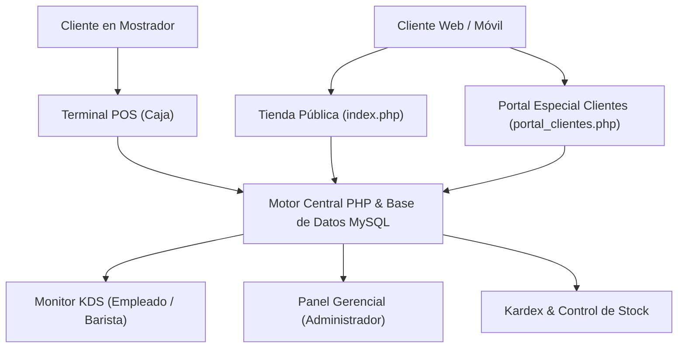
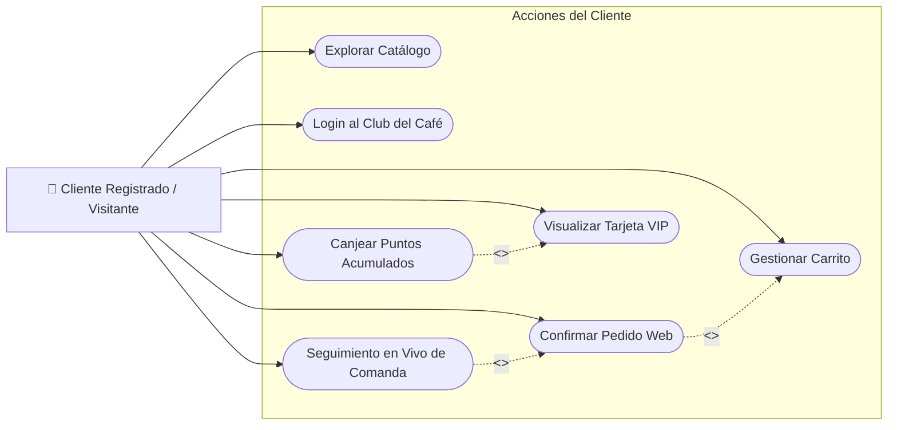
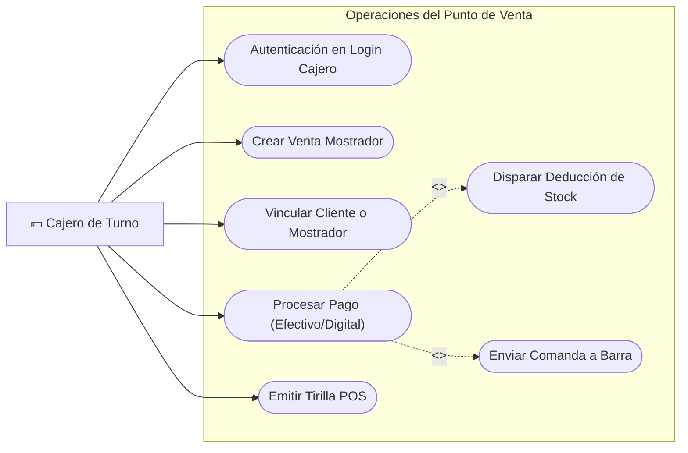
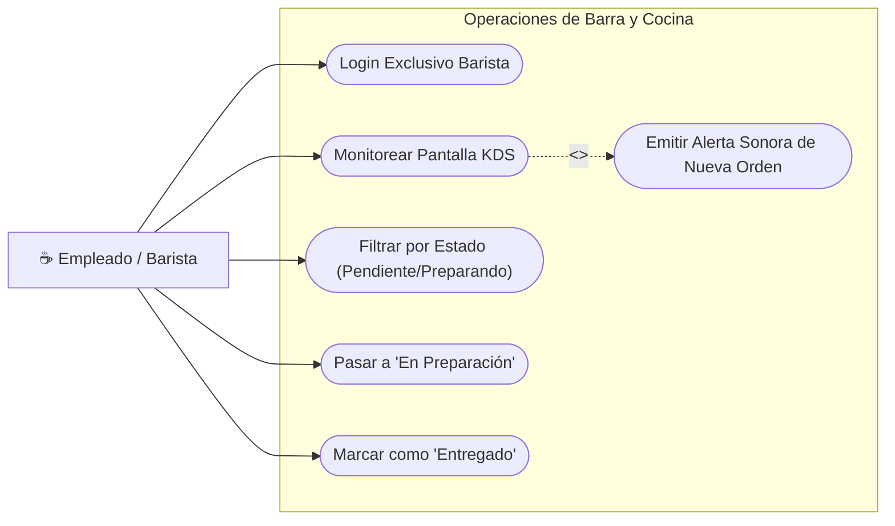
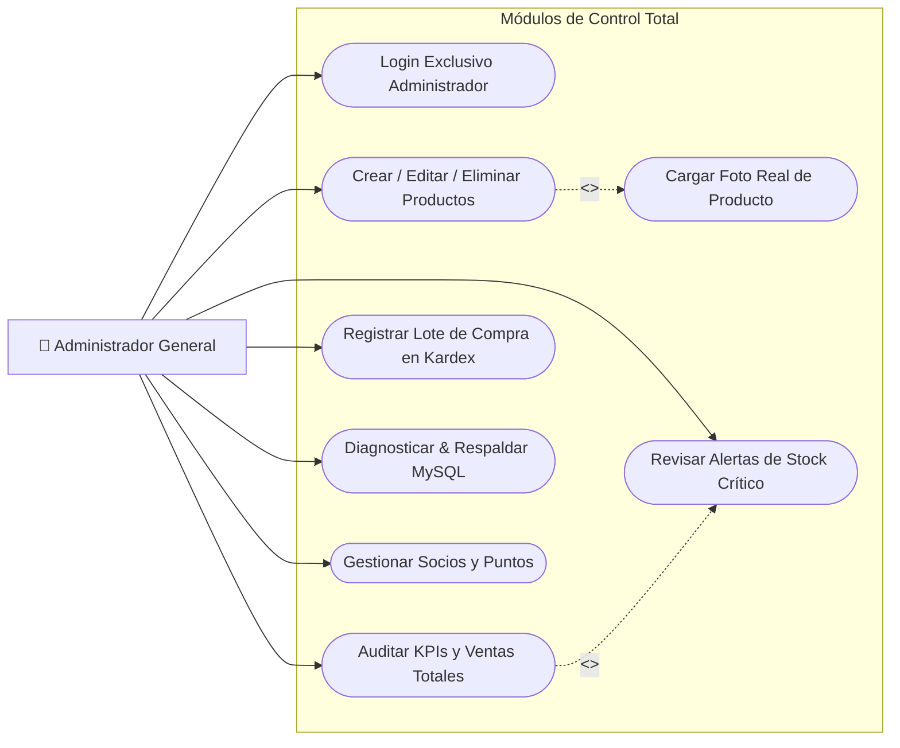
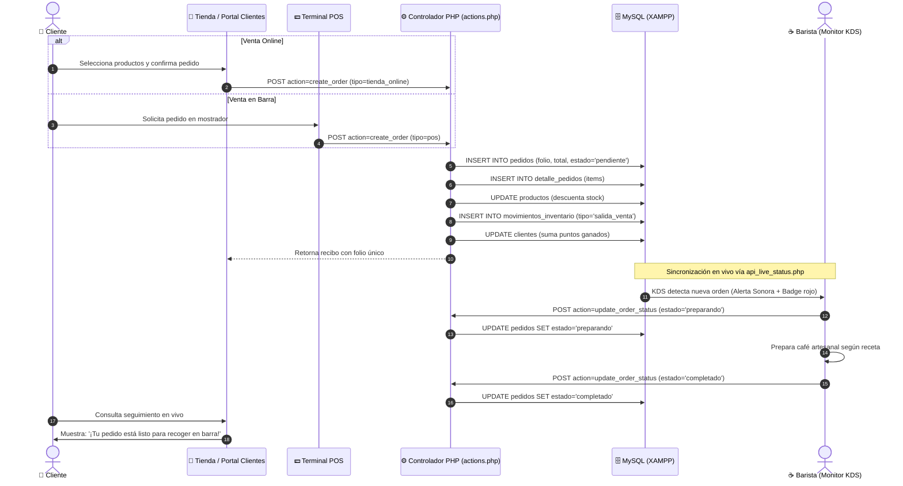
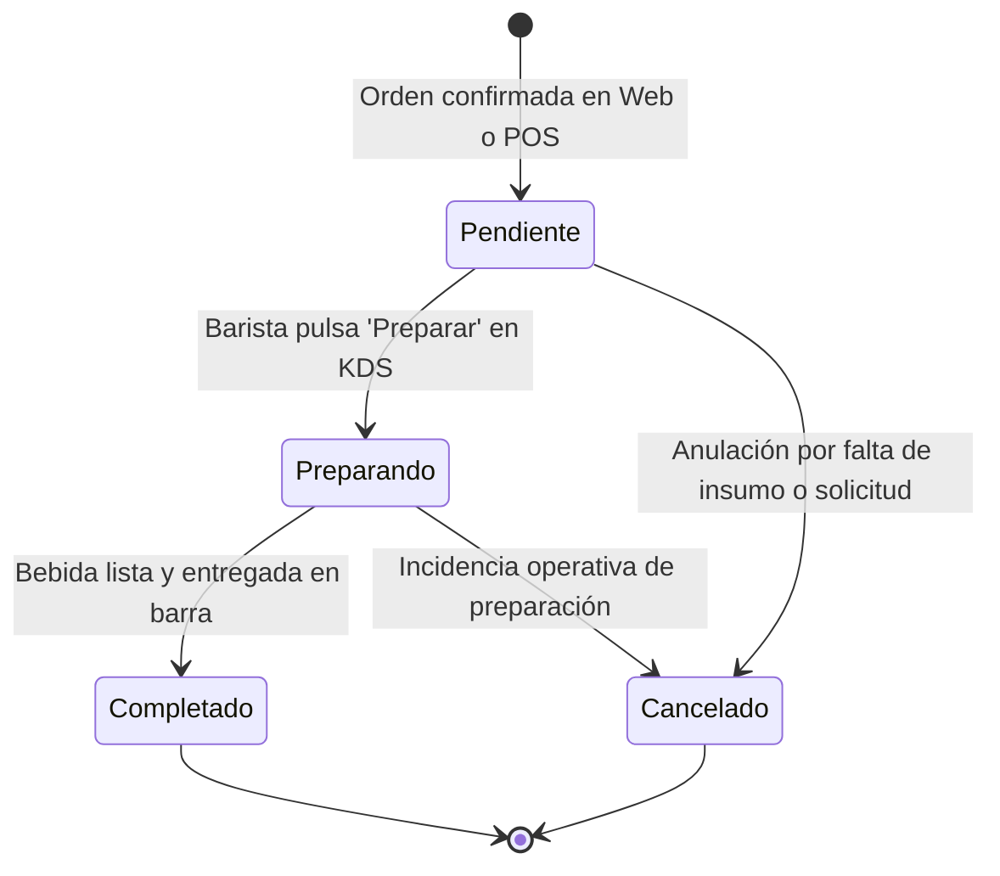

# ESPECIFICACIÓN DE REQUERIMIENTOS DE SOFTWARE (SRS)
## Sistema Integral de Gestión, Tienda Online, POS & KDS
### **La Casa del Buen Café — Neiva, Huila**
**Documento Técnico Oficial bajo el estándar IEEE 830 / ISO/IEC/IEEE 29148**

---

| Metadato del Proyecto | Detalle Oficial |
| :--- | :--- |
| **Nombre del Sistema** | Sistema Integral "La Casa del Buen Café" (E-Commerce, POS, KDS & ERP) |
| **Versión del Software** | Versión 2.5.0-dev |
| **Fecha de Emisión** | Noviembre 2026 |
| **Organización / Cliente** | La Casa del Buen Café |
| **Ubicación Física** | Calle 26 # 16-24 Centro Comercial San Juan Plaza Local 151 Primer Piso, Neiva-Huila |
| **Horario de Operación** | Lunes a Viernes: 9:00 AM - 8:00 PM \| Sábados y Domingos: 10:00 AM - 8:00 PM |
| **Entorno Tecnológico** | PHP 8.2+, Apache 2.4 (XAMPP), MariaDB / MySQL 10.4+, Tailwind CSS, JavaScript Vanilla |
| **Estado del Documento** | Aprobado / En Producción Local y Desarrollo Continuo |

---

## 1. Introducción

### 1.1. Propósito
El presente documento tiene como finalidad definir de manera exhaustiva, formal y técnica la **Especificación de Requerimientos de Software (SRS)** para el ecosistema informático de la cafetería de especialidad **La Casa del Buen Café**. El sistema integra en una sola plataforma:
1. **Tienda Pública E-Commerce**: Catálogo visual con 10 fotos reales de productos, carrito deslizante optimista y rastreo de pedidos por folio.
2. **Portal Especial para Clientes**: Tarjeta de fidelización digital, monedero de puntos (1 punto por cada \$1.000 COP), catálogo para socios y seguimiento de pedidos en vivo.
3. **Portal Muy Privado de Personal**: Intranet operativa con separación estricta para **Administrador**, **Cajero** y **Empleado / Barista**.

### 1.2. Alcance del Sistema
El sistema automatiza integralmente el ciclo de valor comercial y operativo de la cafetería:
- Recepción de pedidos omnicanal (Venta directa en mostrador físico y pedidos web para llevar o entrega local).
- Facturación y cobro en Punto de Venta (Terminal POS).
- Control de comandas en cocina y barra de baristas en tiempo real mediante sistema KDS (*Kitchen Display System*).
- Gestión de inventario en tiempo real con Kardex automatizado y alertas por punto de reorden.
- Fidelización de clientes con acumulación y redención de puntos por café de cortesía y repostería.
- Dashboard analítico para toma de decisiones gerenciales con KPIs de venta, ticket promedio y rentabilidad.

### 1.3. Definiciones, Siglas y Abreviaturas
- **SRS**: *Software Requirements Specification* (Especificación de Requerimientos de Software).
- **POS**: *Point of Sale* (Punto de Venta / Terminal de Facturación).
- **KDS**: *Kitchen Display System* (Monitor de Comandas en Cocina y Barra en tiempo real).
- **Kardex**: Registro estructurado de entradas, salidas y existencias físicas de inventario.
- **Folio**: Código alfanumérico único generado por transacción (`ORD-XXXX` para web, `POS-XXXX` para mostrador).
- **Punto de Reorden**: Umbral mínimo de existencias físicas (`stock_minimo`) que detona alertas de abastecimiento.
- **RF**: Requerimiento Funcional.
- **RNF**: Requerimiento No Funcional.
- **CU**: Caso de Uso.
- **CRUD**: *Create, Read, Update, Delete* (Operaciones fundamentales sobre bases de datos).

### 1.4. Referencias y Estándares
- **IEEE Std 830-1998**: *IEEE Recommended Practice for Software Requirements Specifications*.
- **ISO/IEC/IEEE 29148:2018**: *Systems and software engineering — Life cycle processes — Requirements engineering*.
- **W3C Web Accessibility Guidelines (WCAG 2.1)**: Pautas de accesibilidad y usabilidad.
- **Estándar Tipográfico Corporativo**: Títulos estandarizados a 20px, botones a 14px y párrafos a 14px.

---

## 2. Descripción General del Sistema

### 2.1. Perspectiva del Producto
El software opera bajo una arquitectura web desacoplada en dos frentes principales:

### 2.2. Actores del Sistema
1. **Cliente (`cliente`)**:
   - Explora el menú digital, bebidas y repostería artesanal.
   - Realiza compras en línea seleccionando entrega o retiro.
   - Accede a su **Portal Especial de Clientes** para visualizar su tarjeta VIP digital, consultar sus puntos y rastrear sus comandas en tiempo real.
2. **Cajero (`cajero`)**:
   - Opera la **Terminal POS** para facturar ventas rápidas en barra física.
   - Registra medios de pago (efectivo, Nequi/Daviplata, tarjeta).
   - Busca y afilia clientes al Club de Fidelización en el momento de la compra.
   - Emite tirillas de venta con folio `POS-XXXX`.
3. **Empleado / Barista (`barista`)**:
   - Opera el **Monitor KDS de Comandas** desde una tablet o pantalla táctil en barra.
   - Visualiza en tiempo real los pedidos entrantes (tanto de caja física como de tienda web).
   - Modifica el estado de preparación (*Pendiente* $\rightarrow$ *En Preparación* $\rightarrow$ *Completado/Despachado*).
4. **Administrador (`admin`)**:
   - Posee privilegios totales sobre la plataforma.
   - Monitorea ventas brutas, margen de contribución, ticket promedio y analítica en vivo.
   - Administra el catálogo de productos (CRUD con subida de imágenes, precios, costos).
   - Realiza ajustes de inventario manual (entradas por compra o mermas).
   - Diagnostica y configura la conexión con el servidor MySQL de XAMPP.
5. **Sistema / Motor Automático (`system`)**:
   - Dispara deducciones automáticas de inventario tras cada venta.
   - Calcula el puntaje de fidelización (1 punto por \$1.000 COP).
   - Suministra datos en tiempo real mediante `api_live_status.php`.

### 2.3. Restricciones Generales de Diseño e Implementación
- **Identidad Corporativa**: Paleta basada en café arábica `#120A06`, tostión oscura `#26150E`, crema `#F8F5F0` y oro Huila `#E2AA63`.
- **Regla Estricta Tipográfica**: Títulos a 20px, botones y párrafos a 14px.
- **Aislamiento de Seguridad**: El personal operativo ingresa por el **Portal Muy Privado**, mientras que los consumidores disponen del **Portal Especial para Clientes**. Los accesos entre roles están blindados contra saltos por URL.
- **Infraestructura de Servidor**: Alojamiento local sobre Apache 2.4 con PHP 8.2 en XAMPP, compatible con MariaDB/MySQL 10.4+, con fallback resiliente sobre almacén local JSON (`data/local_store.json`).

---

## 3. Requerimientos Funcionales (RF)

### Módulo 1: Tienda Pública E-Commerce (`index.php`)
- **RF-01 (Catálogo Visual Dinámico)**: El sistema debe mostrar los productos clasificados por categorías (Cafés de Origen, Bebidas Calientes, Bebidas Frías, Repostería, Platanitos y Empanadas), cargando las 10 fotografías reales del local comercial.
- **RF-02 (Búsqueda y Filtrado con Debounce)**: El catálogo debe permitir filtrar por texto con un retardo controlado (*debounce* de 250ms) para evitar sobrecarga del servidor.
- **RF-03 (Bolsa de Compras Optimista)**: La interfaz debe permitir agregar, restar o eliminar ítems de la bolsa con actualización visual inmediata antes de la respuesta sincrónica del servidor.
- **RF-04 (Checkout y Liquidación)**: El sistema debe liquidar subtotales, verificar cantidades y permitir al cliente seleccionar método de pago (Efectivo en mostrador, Transferencia Nequi/Daviplata o Datáfono).
- **RF-05 (Generación de Comprobante)**: Tras procesar la orden, se debe emitir un recibo digital con folio único (`ORD-XXXX`), desglose de ítems, fecha y hora.
- **RF-06 (Rastreador Público de Pedidos)**: El cliente debe poder ingresar su número de folio en un formulario para consultar el estado en vivo de su pedido (*Pendiente*, *En Preparación*, *Completado*).

### Módulo 2: Portal Especial para Clientes (`portal_clientes.php`)
- **RF-07 (Autenticación Exclusiva de Clientes)**: El portal debe permitir el inicio de sesión y registro automático de clientes mediante correo electrónico, asignando 50 puntos de bienvenida a los nuevos registros.
- **RF-08 (Tarjeta VIP Digital)**: El sistema debe renderizar una tarjeta virtual personalizada con el nombre del cliente, ID único (`CBC-XXXX`) y saldo de puntos.
- **RF-09 (Sistema de Niveles de Fidelización)**: El sistema debe categorizar al socio según sus puntos: Bronce (< 100 pts), Plata (100 - 200 pts) y Oro Diamante (> 200 pts).
- **RF-10 (Barra de Recompensas y Metas)**: El portal debe mostrar una barra interactiva de progreso para el canje de premios (100 pts = Café 8oz gratis; 150 pts = Torta/Empanada gratis; 300 pts = Café 250g en grano gratis).
- **RF-11 (Línea de Tiempo de Comandas en Vivo)**: El socio debe poder ver el avance de sus órdenes activas mediante una línea de tiempo gráfica sincronizada con el KDS.
- **RF-12 (Catálogo Directo de Reorden)**: El cliente debe poder solicitar sus productos habituales con un solo toque sin tener que diligenciar nuevamente su dirección en Neiva.

### Módulo 3: Portal Privado — Terminal de Venta POS (`views/pos.php`)
- **RF-13 (Búsqueda Ágil en Barra)**: La interfaz POS debe permitir localizar productos por código SKU (`TOR-001`, `BEB-001`), nombre o categoría en una cuadrícula táctil optimizada.
- **RF-14 (Asociación de Cliente a la Venta)**: El cajero debe poder vincular la venta a un cliente existente para asignarle puntos o registrar un nuevo cliente al instante. Si no se indica, se asigna al *Cliente Mostrador*.
- **RF-15 (Múltiples Formas de Pago)**: El cajero debe registrar pagos en Efectivo (con cálculo automático de cambio/vueltas), Nequi, Daviplata o Tarjeta débito/crédito.
- **RF-16 (Emisión de Tirilla POS)**: Al confirmar la transacción, el sistema debe generar la tirilla de caja con folio `POS-XXXX`, imprimiendo el encabezado fiscal, desglose de IVA y puntos otorgados.
- **RF-17 (Deducción Automática de Stock)**: Cada venta confirmada en el POS debe decrementar las unidades del inventario inmediatamente.
- **RF-18 (Envío Automático a KDS)**: Las bebidas y alimentos preparados que requieran elaboración deben proyectarse inmediatamente en la pantalla del barista.

### Módulo 4: Portal Privado — Monitor KDS de Barra y Cocina (`views/pedidos.php`)
- **RF-19 (Monitor KDS en Tiempo Real)**: La pantalla debe mostrar tarjetas individuales para cada orden entrante, ordenadas cronológicamente con indicador de tiempo transcurrido.
- **RF-20 (Filtrado por Estado de Elaboración)**: El barista debe poder filtrar comandas por: *Todas*, *Pendientes* (color azul), *En Preparación* (color ámbar animado) y *Completadas* (color verde).
- **RF-21 (Cambio de Estado en 1 Toque)**: El barista debe cambiar el estado de la comanda con botones táctiles directos, actualizando la base de datos y la vista del cliente sin recargar la página.
- **RF-22 (Diferenciación de Canal)**: Cada comanda debe destacar visualmente si proviene de la *Tienda Online* o de la *Caja POS Mostrador*.
- **RF-23 (Alerta Sonora y Contador Badge)**: El monitor debe emitir un pitido de notificación y actualizar el contador numérico parpadeante en el navbar cada vez que ingrese una comanda nueva.
- **RF-24 (Observaciones y Personalizaciones)**: El KDS debe resaltar en texto legible notas especiales del cliente (ej. *"Leche deslactosada"*, *"Tueste medio"*, *"Sin azúcar"*).

### Módulo 5: Portal Privado — Inventario, Kardex y Catálogo CRUD (`views/inventario.php`)
- **RF-25 (CRUD Completo de Productos)**: El administrador debe poder crear, editar, pausar y eliminar productos del catálogo, definiendo código, nombre, categoría, costo, precio de venta y stock mínimo.
- **RF-26 (Subida y Almacenamiento de Fotos Reales)**: El sistema debe procesar y guardar imágenes en `uploads/` asociadas al producto.
- **RF-27 (Kardex Inmutable de Movimientos)**: Toda alteración de stock (por venta, ajuste manual, compra a proveedor o merma) debe guardarse en la tabla `movimientos_inventario` con fecha, tipo y responsable.
- **RF-28 (Alertas Visuales de Stock Crítico)**: Los productos cuyo stock sea inferior o igual al `stock_minimo` deben marcarse con fondo rojo y alimentar la tarjeta de alertas del dashboard.
- **RF-29 (Ajuste Rápido de Existencias)**: El administrador debe poder ingresar lotes de inventario sumando cantidades con una nota justificativa.
- **RF-30 (Gestión de Categorías)**: Permite administrar las familias de productos (Cafés, Bebidas, Empanadas, Tortas, Platanitos).

### Módulo 6: Portal Privado — Dashboard y Analítica Financiera (`views/dashboard.php`)
- **RF-31 (Métricas Financieras en Vivo)**: El panel debe consolidar las Ventas Totales Históricas (\$ COP), Ventas del Día, Total de Pedidos y Puntos de Fidelización otorgados.
- **RF-32 (Gráficas de Tendencia)**: Representación visual del volumen de ventas comparando canal Web versus mostrador POS mediante Chart.js.
- **RF-33 (Top Productos Más Vendidos)**: Tabla de clasificación con las bebidas y alimentos con mayor rotación comercial.
- **RF-34 (Últimos Pedidos en Vivo)**: Flujo en directo de las compras más recientes con botón de acceso a la comanda.
- **RF-35 (Refresco Asincrónico)**: Consulta periódica vía `api_live_status.php` para mantener los números actualizados en segundo plano.

### Módulo 7: Seguridad, Roles y Autenticación (`includes/actions.php` & `config/supabase.php`)
- **RF-36 (Separación Estricta de Portales)**:
  - Portal Especial Clientes: accesible exclusivamente para rol `cliente`.
  - Portal Muy Privado: accesible exclusivamente para roles operativos (`admin`, `cajero`, `barista`).
- **RF-37 (Validación de Rol en Login)**: Si un empleado con rol de Cajero intenta iniciar sesión por el formulario del Administrador, el sistema debe denegar el acceso e indicar el portal correcto.
- **RF-38 (Bloqueo de Módulos por Puesto)**:
  - Cajero: acceso únicamente a POS, Comandas y Clientes. Redirección forzada si intenta acceder a Dashboard, Inventario o Configuración.
  - Barista: acceso únicamente a Comandas KDS. Redirección forzada si intenta acceder a Caja, Inventario o Dashboard.
  - Administrador: acceso irrestricto a todos los módulos.
- **RF-39 (Cierre de Sesión Seguro)**: Destrucción de variables de sesión en servidor y redirección al portal de origen correspondiente.
- **RF-40 (Cifrado de Claves)**: Las contraseñas en base de datos deben estar hasheadas con algoritmo seguro `bcrypt` (`password_hash`).
- **RF-41 (Prevención de Inyecciones)**: Todas las consultas a MySQL deben ejecutarse mediante sentencias preparadas PDO con paso de parámetros sanitizados.
- **RF-42 (Eliminación de Bypasses)**: No se permite ningún parámetro de URL libre que altere el rol del usuario sin autenticación formal.

### Módulo 8: Base de Datos y Conectividad (`config/conexion_mysql.php`)
- **RF-43 (Conexión Primaria MySQL XAMPP)**: Conexión mediante PDO a la base `la_casa_del_buen_cafe` en `localhost:3306`.
- **RF-44 (Respaldo Automático Local JSON)**: Si el servicio MySQL se detiene en XAMPP, el adaptador debe alternar de forma transparente a `data/local_store.json` para evitar interrupción del servicio en tienda.
- **RF-45 (Módulo de Diagnóstico en Vivo)**: Herramienta interna para probar conectividad, conteo de registros por tabla y reparación de esquemas.
- **RF-46 (Conectividad en Red Local Wi-Fi)**: Generación automática de enlace e IP local (`http://10.X.X.X/La_casa_del_buen_cafe/`) con código QR para conectar celulares, comandas y datáfonos inalámbricos.
- **RF-47 (Compresión y Optimización de Entrega)**: Compresión HTTP brotli/gzip y cabeceras de expiración en `.htaccess` para archivos estáticos.
- **RF-48 (Cola de Tareas en Segundo Plano)**: Cola no bloqueante (`includes/job_queue.php`) para tareas lentas (envío de correos o generación de reportes).

---

## 4. Diagramas UML de Casos de Uso

### 4.1. Diagrama Global de Casos de Uso del Sistema

```mermaid
flowchart TD
    subgraph Actores ["Actores del Sistema"]
        C["👤 Cliente"]
        CJ["💵 Cajero"]
        B["☕ Empleado / Barista"]
        A["👑 Administrador"]
    end

    subgraph PortalClientes ["Portal Especial de Clientes"]
        UC01(["UC-01: Explorar Catálogo & Fotos Reales"])
        UC02(["UC-02: Agregar a Bolsa & Checkout"])
        UC03(["UC-03: Iniciar Sesión / Registro Club"])
        UC04(["UC-04: Consultar Puntos & Tarjeta VIP"])
        UC05(["UC-05: Rastrear Comanda en Tiempo Real"])
        UC06(["UC-06: Canjear Premios"])
    end

    subgraph PortalPrivadoPOS ["Portal Privado: Terminal POS"]
        UC07(["UC-07: Iniciar Turno de Caja"])
        UC08(["UC-08: Facturar Venta Mostrador"])
        UC09(["UC-09: Buscar / Afiliar Cliente a Club"])
        UC10(["UC-10: Registrar Pago en Efectivo/Tarjeta"])
        UC11(["UC-11: Imprimir Tirilla de Venta"])
    end

    subgraph PortalPrivadoKDS ["Portal Privado: Monitor KDS Barra"]
        UC12(["UC-12: Iniciar Sesión de Barista"])
        UC13(["UC-13: Visualizar Comandas Entrantes"])
        UC14(["UC-14: Cambiar Estado de Preparación"])
        UC15(["UC-15: Notificar Despacho de Pedido"])
    end

    subgraph PortalPrivadoAdmin ["Portal Privado: Gestión Gerencial"]
        UC16(["UC-16: Iniciar Sesión Administrador"])
        UC17(["UC-17: Monitorear Dashboard & KPIs Financieros"])
        UC18(["UC-18: Administrar Catálogo & Fotos CRUD"])
        UC19(["UC-19: Ajustar Kardex & Entradas de Lote"])
        UC20(["UC-20: Gestionar Base de Datos MySQL"])
    end

    C --> UC01
    C --> UC02
    C --> UC03
    C --> UC04
    C --> UC05
    C --> UC06

    CJ --> UC07
    CJ --> UC08
    CJ --> UC09
    CJ --> UC10
    CJ --> UC11

    B --> UC12
    B --> UC13
    B --> UC14
    B --> UC15

    A --> UC16
    A --> UC17
    A --> UC18
    A --> UC19
    A --> UC20
    A --> UC08
    A --> UC13
```

---

### 4.2. Casos de Uso Detallados del Actor Cliente

---

### 4.3. Casos de Uso del Actor Cajero (Terminal POS)

---

### 4.4. Casos de Uso del Actor Empleado / Barista (Monitor KDS)

---

### 4.5. Casos de Uso del Actor Administrador (Intranet Operativa)

---

### 4.6. Diagrama de Secuencia UML: Ciclo de Vida Completo de un Pedido

---

### 4.7. Diagrama de Estados UML: Ciclo de Vida de una Comanda

---

## 5. Especificación Detallada de Casos de Uso Clave

### CU-01: Realizar Pedido en Tienda Pública
- **Actor Principal**: Cliente (público o socio).
- **Precondiciones**: Existencias disponibles en el inventario del producto solicitado.
- **Flujo Principal**:
  1. El cliente ingresa a `http://localhost/La_casa_del_buen_cafe/`.
  2. Navega por el catálogo visual y filtra por categoría (ej. Cafés de Origen, Tortas).
  3. Pulsa "Agregar a Mi Bolsa" sobre el producto deseado.
  4. Abre la bolsa de compras flotante y verifica el resumen.
  5. Completa sus datos (Nombre, Teléfono, Método de Pago, Dirección de entrega o retiro en San Juan Plaza Local 151).
  6. Pulsa "Confirmar Pedido".
  7. El sistema registra el pedido con folio `ORD-XXXX`, descuenta el stock de inmediato y le otorga puntos de socio si indicó su correo.
  8. El sistema muestra la pantalla de recibo digital con botón para consultar seguimiento.
- **Flujos Alternos**:
  - *4a. Stock agotado*: El sistema notifica al usuario que el producto no dispone de existencias suficientes y bloquea el botón de envío.
- **Postcondiciones**: La orden queda registrada en estado `pendiente`, proyectándose inmediatamente en el monitor KDS del barista.

---

### CU-02: Consultar Puntos y Canjear Recompensas en Portal Clientes
- **Actor Principal**: Cliente Socio del Club del Café.
- **Precondiciones**: Disponer de una cuenta de correo registrada.
- **Flujo Principal**:
  1. El cliente accede a `portal_clientes.php`.
  2. Si no tiene sesión activa, ingresa su correo y contraseña (o usa el botón de 1-clic para clientes demo como *Estefanía Olaya*).
  3. El sistema valida las credenciales y carga el perfil del cliente.
  4. El portal renderiza la tarjeta VIP digital con su número de socio (`CBC-XXXX`) y saldo de puntos.
  5. Si el saldo supera los 100 puntos, el sistema habilita el botón de recompensa para reclamar un *Café de Origen 8oz Gratis*.
  6. El socio visualiza el historial de todas sus órdenes pasadas y el estado en vivo de las órdenes activas.
- **Postcondiciones**: El cliente conoce su saldo y puede acudir al mostrador a canjear sus premios presentando su tarjeta digital.

---

### CU-03: Facturar y Cobrar Orden en Terminal POS
- **Actor Principal**: Cajero de Turno.
- **Precondiciones**: Cajero debidamente autenticado en `login_cajero.php` y turno de caja abierto.
- **Flujo Principal**:
  1. El cliente físico se acerca al mostrador de la cafetería en el Centro Comercial San Juan Plaza.
  2. El cajero selecciona los productos solicitados en la cuadrícula táctil del módulo POS (`views/pos.php`).
  3. El cajero pregunta al cliente su número telefónico o correo para asignarle sus puntos de socio en el Club.
  4. Selecciona el medio de pago: Efectivo, Nequi/Daviplata o Tarjeta.
  5. Si es efectivo, digita el monto recibido y el sistema calcula automáticamente el cambio a devolver.
  6. Pulsa "Cobrar & Facturar".
  7. El sistema genera el comprobante con folio `POS-XXXX`, rebaja las unidades de la bodega e inserta la comanda en la pantalla del barista.
- **Postcondiciones**: Venta registrada, stock actualizado y comanda proyectada en barra.

---

### CU-04: Gestionar Preparación en Monitor KDS (Barista)
- **Actor Principal**: Empleado / Barista.
- **Precondiciones**: Barista autenticado en `login_barista.php` con pantalla de comandas visible en barra.
- **Flujo Principal**:
  1. Al ingresar una comanda, el monitor emite un sonido característico y actualiza el contador rojo de órdenes pendientes.
  2. El barista visualiza la comanda con sus ítems (ej. *2x Cappuccino de Origen con leche de avena*).
  3. Pulsa el botón "Preparar". La orden pasa a color ámbar y estado `preparando`.
  4. El barista muele el café especial del Huila, extrae los espressos y texturiza la leche.
  5. Al finalizar la elaboración, pulsa "Completar / Despachar".
  6. La orden pasa a color verde `completado` y se traslada al historial del turno.
  7. El cliente recibe la actualización de estado en su pantalla o celular en tiempo real.
- **Postcondiciones**: Comanda finalizada y tiempo de preparación registrado en el sistema.

---

### CU-05: Ajuste de Inventario y Kardex (Administrador)
- **Actor Principal**: Administrador General.
- **Precondiciones**: Sesión autenticada en `login_admin.php`.
- **Flujo Principal**:
  1. El administrador entra a la pestaña "Inventario CRUD" (`views/inventario.php`).
  2. Revisa la tabla de existencias y las filas en rojo con alertas de stock crítico.
  3. Selecciona un producto (ej. *Paquete Platanitos Mixtos 150g*) y pulsa "Ajustar Stock / Entrada".
  4. Digita la cantidad que ingresó de proveedor (ej. +50 unidades) y la nota justificativa (*"Compra a Distribuidora del Huila - Factura 4402"*).
  5. Pulsa "Guardar Movimiento".
  6. El sistema actualiza el campo `stock` de la tabla `productos` y crea un registro inmutable en `movimientos_inventario` con el usuario responsable.
- **Postcondiciones**: Existencias reales cuadradas y trazabilidad registrada en el Kardex.

---

## 6. Requerimientos No Funcionales (RNF)

### 6.1. Rendimiento y Escalabilidad
- **RNF-01 (Tiempo de Respuesta en Navegación)**: Las páginas públicas y portales deben responder con un tiempo de carga del DOM inferior a **800 ms** bajo condiciones estándar de red local.
- **RNF-02 (Transmisión Asincrónica sin Bloqueo)**: Las consultas de comprobación de comandas (`api_live_status.php`) deben realizarse mediante peticiones AJAX/Fetch ligeras con consumo menor a 15 KB por petición.
- **RNF-03 (Compresión de Activos)**: Todos los recursos estáticos (CSS, JS, SVG, fuentes tipográficas) deben servirse con compresión gzip/brotli activa mediante directivas en `.htaccess`.
- **RNF-04 (Optimización de Imágenes)**: Las fotografías de productos deben servirse en resoluciones optimizadas para web con carga diferida (*lazy loading* nativo `loading="lazy"`).
- **RNF-05 (Concurrencia Simultánea)**: El servidor Apache local en XAMPP debe soportar al menos 50 conexiones simultáneas sin degradación en el servicio del POS y el KDS.

### 6.2. Seguridad y Privacidad
- **RNF-06 (Aislamiento de Privilegios)**: Ningún usuario con rol de `cliente`, `cajero` o `barista` podrá tener acceso a las tablas administrativas (`dashboard`, `inventario`, `configuracion`).
- **RNF-07 (Autenticación Criptográfica)**: El 100% de las contraseñas de personal deben almacenarse con hashing seguro mediante `password_hash($pass, PASSWORD_BCRYPT)`.
- **RNF-08 (Protección de Inyecciones SQL)**: Se prohíbe la concatenación directa de variables en consultas SQL; toda operación a base de datos debe emplear sentencias parametrizadas PDO.
- **RNF-09 (Sanitización XSS)**: Cualquier salida de datos generada por el usuario (nombres, notas de comanda, comentarios) debe escaparse mediante `htmlspecialchars($str, ENT_QUOTES, 'UTF-8')`.
- **RNF-10 (Protección de Sesiones)**: Las cookies de sesión deben implementar directivas seguras `HttpOnly` y prevenir fijación de sesión mediante regeneración de ID tras login.

### 6.3. Usabilidad y Diseño
- **RNF-11 (Preservación del Estándar Tipográfico Corporativo)**:
  - Títulos principales y de tarjetas: estrictamente a **20px** (`font-weight: 700`).
  - Botones y llamadas a la acción: estrictamente a **14px** (`font-weight: 700` o `600`).
  - Textos descriptivos y párrafos: estrictamente a **14px** (`line-height: 1.6`).
- **RNF-12 (Paleta de Colores Exclusiva)**: Se deben mantener los tonos café arábica `#120A06`, tostión suave `#26150E`, crema `#F8F5F0` y oro Huila `#E2AA63`.
- **RNF-13 (Diseño Totalmente Responsivo)**: La plataforma debe adaptarse fluidamente a dispositivos móviles (celulares de clientes), tablets táctiles (pantallas de comandas KDS) y monitores de escritorio (caja POS y administración).
- **RNF-14 (Efecto Skeleton Loading)**: Durante la carga de productos y estadísticas, la interfaz debe mostrar esqueletos animados con efecto shimmer para maximizar la percepción de agilidad del usuario.

### 6.4. Disponibilidad y Confiabilidad
- **RNF-15 (Alta Disponibilidad Local)**: El sistema debe operar 24/7 en la red de la cafetería con una disponibilidad proyectada del **99.5%** durante el horario de atención (9:00 AM a 8:00 PM).
- **RNF-16 (Mecanismo Fallback de Resiliencia)**: En caso de detención imprevista del motor MySQL en XAMPP, el sistema no debe arrojar error fatal de pantalla blanca, sino activar el almacén redundante `data/local_store.json`.
- **RNF-17 (Integridad Transaccional)**: Toda orden debe descontar stock y generar su respectivo detalle de forma atómica; si alguna subconsulta falla, se revierte la operación.

### 6.5. Compatibilidad y Portabilidad
- **RNF-18 (Compatibilidad de Navegadores)**: Compatible con Google Chrome (v100+), Mozilla Firefox (v100+), Apple Safari (v15+) y Microsoft Edge.
- **RNF-19 (Impresión Térmica)**: El módulo POS debe formatear las tirillas para anchos estándar de 58mm y 80mm de impresoras térmicas ESC/POS.
- **RNF-20 (Conexión Multi-dispositivo)**: El servidor debe permitir el acceso directo mediante la dirección IP de la red local Wi-Fi generada en `api_live_status.php`.

---

## 7. Requerimientos de Interfaz de Usuario y Hardware

### 7.1. Interfaces de Software
| Interfaz | Archivo Principal | Actor Destinatario | Descripción |
| :--- | :--- | :--- | :--- |
| **Tienda E-Commerce** | `index.php` | Público General / Clientes | Catálogo de productos, 10 fotos reales, carrito optimista y checkout. |
| **Portal Especial Clientes** | `portal_clientes.php` | Socios del Club | Tarjeta VIP digital, monedero de puntos, recompensas y pedidos en vivo. |
| **Portal Muy Privado Personal**| `portal_privado.php` / `admin.php` | Colaboradores Internos | Intranet con candado para Admin, Cajero y Barista. |
| **Terminal de Venta POS** | `views/pos.php` | Cajero / Administrador | Punto de venta táctil, liquidación de efectivo y comprobantes. |
| **Monitor KDS de Barra** | `views/pedidos.php` | Empleado / Barista | Pantalla de cocina para elaboración y despacho de pedidos. |
| **Inventario & Kardex** | `views/inventario.php` | Administrador | CRUD de catálogo, existencias físicas y stock mínimo. |
| **Dashboard Gerencial** | `views/dashboard.php` | Administrador | KPIs financieros, analítica y gráficas en tiempo real. |

### 7.2. Interfaces de Hardware
- **Caja Registradora / Terminal POS**: Computador de escritorio o laptop conectada a cajón monedero estándar RJ11 e impresora térmica USB.
- **Monitor de Preparación KDS**: Tablet Android/iPad de 10" o superior, o monitor táctil colocado en la barra de baristas.
- **Dispositivos Móviles de Clientes**: Teléfonos inteligentes Android e iOS conectados a la red Wi-Fi de clientes para ver el menú y su portal de puntos.

---

## 8. Matriz de Trazabilidad: Requerimientos vs. Casos de Uso

| ID Requerimiento | Descripción Sintética | Caso de Uso Asociado | Componente / Archivo |
| :--- | :--- | :--- | :--- |
| **RF-01** | Catálogo con 10 fotos reales | CU-01 | `index.php` |
| **RF-02** | Búsqueda con debounce 250ms | CU-01 | `index.php` |
| **RF-03** | Bolsa de compras optimista | CU-01 | `index.php` |
| **RF-04** | Checkout con métodos de pago | CU-01 | `index.php` |
| **RF-05** | Emisión de recibo digital ORD-XXXX | CU-01 | `index.php` |
| **RF-06** | Rastreador público de órdenes | CU-01 | `index.php` |
| **RF-07** | Autenticación y registro de clientes | CU-02, CU-07 | `portal_clientes.php`, `login_cliente.php` |
| **RF-08** | Tarjeta VIP digital CBC-XXXX | CU-02 | `portal_clientes.php` |
| **RF-09** | Niveles de socio (Bronce, Plata, Oro) | CU-02 | `portal_clientes.php` |
| **RF-10** | Canje de premios por puntos | CU-02 | `portal_clientes.php` |
| **RF-11** | Línea de tiempo de órdenes en vivo | CU-02 | `portal_clientes.php` |
| **RF-12** | Catálogo directo de socios | CU-02 | `portal_clientes.php` |
| **RF-13** | Búsqueda ágil táctil en POS | CU-03 | `views/pos.php` |
| **RF-14** | Vinculación de cliente y puntos en caja| CU-03 | `views/pos.php` |
| **RF-15** | Registro de pagos efectivo y digital | CU-03 | `views/pos.php` |
| **RF-16** | Emisión de tirilla POS-XXXX | CU-03 | `views/pos.php` |
| **RF-17** | Deducción automática de stock | CU-03 | `includes/actions.php` |
| **RF-18** | Envío automático a KDS | CU-03, CU-04 | `database/mysql_schema.sql` |
| **RF-19** | Monitor de comandas en vivo | CU-04 | `views/pedidos.php` |
| **RF-20** | Filtro por estado de preparación | CU-04 | `views/pedidos.php` |
| **RF-21** | Cambio de estado táctil en 1 toque | CU-04 | `views/pedidos.php` |
| **RF-22** | Diferenciación de canal Web vs POS | CU-04 | `views/pedidos.php` |
| **RF-23** | Alerta auditiva de orden nueva | CU-04 | `views/pedidos.php` |
| **RF-24** | Notas y personalizaciones del café | CU-04 | `views/pedidos.php` |
| **RF-25** | CRUD de productos y precios | CU-05 | `views/inventario.php` |
| **RF-26** | Carga de fotos reales en uploads/ | CU-05 | `includes/actions.php` |
| **RF-27** | Kardex inmutable de movimientos | CU-05 | `database/mysql_schema.sql` |
| **RF-28** | Alertas de stock crítico | CU-05, CU-06 | `views/dashboard.php` |
| **RF-29** | Ajuste manual de existencias | CU-05 | `views/inventario.php` |
| **RF-31** | Indicadores KPI de venta en vivo | CU-06 | `views/dashboard.php` |
| **RF-32** | Gráficas comparativas Chart.js | CU-06 | `views/dashboard.php` |
| **RF-36** | Separación total de portales | CU-07 | `portal_clientes.php`, `portal_privado.php` |
| **RF-37** | Validación estricta de rol | CU-07 | `config/supabase.php` |
| **RF-38** | Restricción por rol de módulos | CU-07 | `admin.php` |
| **RF-43** | Conexión a MySQL XAMPP | CU-08 | `config/conexion_mysql.php` |
| **RF-44** | Fallback redundante a JSON local | CU-08 | `config/supabase.php` |
| **RF-46** | Acceso por IP local y código QR | CU-08 | `api_live_status.php` |

---

## 9. Aprobación y Firmas del Documento

El presente documento de Especificación de Requerimientos de Software (SRS) ha sido elaborado y validado para el sistema informático de **La Casa del Buen Café**. Cumple formalmente con los requerimientos operativos de la sede física en el **Centro Comercial San Juan Plaza Local 151 Primer Piso, Neiva-Huila**, y establece la base de desarrollo para el equipo técnico.

---
**Documento Oficial de Ingeniería de Software — La Casa del Buen Café © 2026**
